# Release review · 2026-10-28

## Geography-first wilderness roads

The previous road changes passed geometric safety tests but still looked like
hex-boundary tracks or rounded tubing. Their main error was treating every
ordinary terrain picture as a literal rectangular obstacle, then forcing seeded
bends into otherwise direct corridors. The old minimum-bend assertions measured
that effect rather than convincing geography; those assertions are removed.

New road generation uses terrain costs, continuous elevation and grade, river
crossing costs, fixed settlement approaches and real landmark clearance. A fine
route search retains the terrain-following course during simplification; it
allows direct stretches where the land supports them. Main settlement routes
form solid, fine-ink trunks. Finer dashed roads serve villages and selected nearby
mines, towers or ruins. Additional links are considered when they substantially
shorten travel; they are optional, not a guaranteed cycle in every region.

Ordinary terrain artwork is composed after the network. A symbol can shift or
shrink inside its own hex, or be omitted in a crowded corridor, without changing
the travel terrain. Settlements and keyed landmarks remain fixed. Exact art
placements are saved with the map. Rendering and label obstacles use those
placements; bridges, selection and erasure follow the actual road curves.
Main/minor road samples in the legend match the drawing. Existing road geometry
and manually drawn line styles remain intact until regeneration.

Review found and fixed failed-icon placeholders exceeding their declared bounds,
extreme finite imported rotations overflowing artwork geometry, and manually
added site numbers overlapping shifted artwork or leaving their hex in coordinate
mode. Seed edits now survive a tool-panel rebuild before the field blurs.

Validation:

- All eight Node suites pass **279 tests**: 52 town, 59 variety, 14 realism,
  10 import, 8 unavailable-engine, 52 wilderness, 67 dungeon and 17 storage.
  The complete final wilderness run passed all 52 together, including an
  independently verified useful alternate cycle. There are no failures or skips.
- Geography fixtures verify efficient open-land routes, lowland ridge bypasses,
  fixed landmarks, actual road hierarchy and settlement connectivity. Spatial
  checks use the final rendered path and saved artwork positions, retaining
  full-width shore/frame/reserve clearance, dry junctions and real bridges.
- JSON, legacy lines, rotated placeholders, shifted-art key placement, curve
  picking and the edited-seed UI path have regression coverage.
- Native Chrome passes **2,468 desktop** and **2,470 phone-size** checks with
  no browser warnings or errors. The phone viewport was verified before running
  the suite and the temporary override was reset. Three generated landscapes
  were visually inspected, including an island region and mobile generation.
- Workflow lint, syntax/shipped-asset checks and whitespace checks pass. Changes
  remain local and unpublished.

Normal 9 × 12 generation in a standalone probe took about 0.35 seconds. One
120 × 120 generator probe took about 10 seconds and 87 MB of heap; this is not a
mobile-browser performance benchmark. Large maps still run generation on the
main thread. Reference maps informed route hierarchy and composition; no source
code or artwork from those maps was copied. See [CREDITS.md](CREDITS.md).

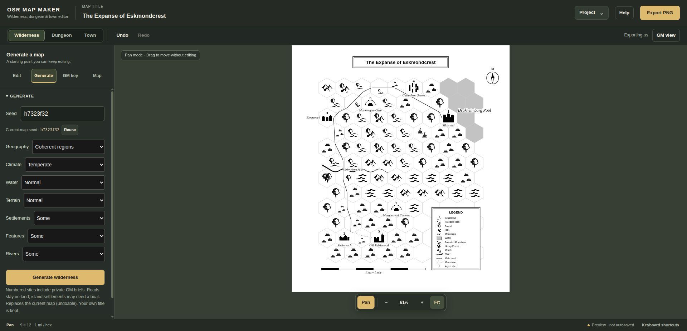
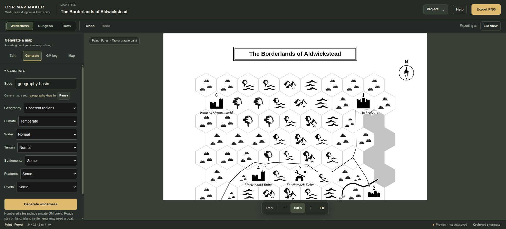
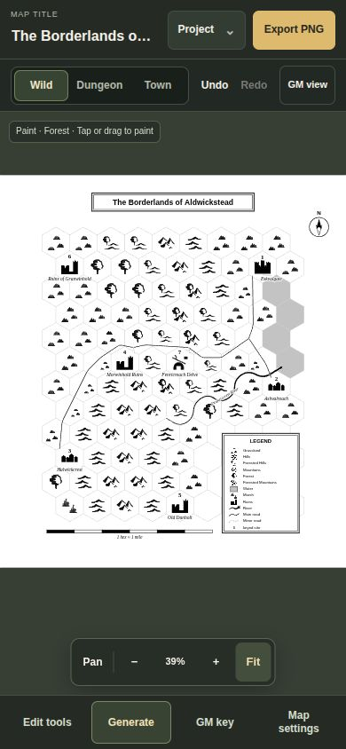

## Unavailable Town engine

The missing-`town.js` review finding was confirmed. A stored town can exist when
its separate runtime fails to load. A shared availability guard stops Town
selection, erase, building/site placement, movement, stale deletion, keyboard
actions and deferred site commits before data or history changes. The map shows
an engine-load explanation instead of an empty-town prompt; edit attempts show
reload guidance. JSON backup data remains available. Inherited outbuilding
privacy is respected even when the runtime helper is unavailable. The dedicated
eight-test suite includes loaded-engine positive cases and retained private data.

## Town blocks, properties and land use

The earlier town generator placed individual houses along streets, with an oval
perimeter and a decorative ring of fields. The replacement divides the actual
street/bank/perimeter network into blocks, allocates non-overlapping properties
with street frontage, and then places main buildings, selective outbuildings and
reserved gardens, courts or workyards inside them.

- Central commercial properties have compact frontages and small setbacks.
  Outskirts have deeper garden plots; riverfronts support craft workyards.
  Settlement size and density change occupied property area, not shed counts.
  Visual review rejected an initially suburban dense-city result; the final
  version leaves room for opposing street fronts and uses compact urban courts.
- Asymmetric polygonal envelopes vary with the street plan. Agricultural
  holdings follow countryside approaches with real access tracks, irregular
  field boundaries, variable strips, orchards and pasture. Some approaches have
  no holdings; fields no longer form an evenly spaced ring around the wall.
- Service briefs match visible land use: herbalists prefer real gardens; inns
  only promise stables when a suitable annex exists. Outbuildings are separate
  editable roofs, with inherited privacy from their main building.
- Building moves keep land fixed; leaving a plot detaches ownership. Deletion
  unlinks surviving keys, structures and access records. History and JSON loads
  preserve the new geometry, stable keys and private notes. Older maps retain
  their original geometry until regeneration.
- Import repair cannot reveal inherited-private outbuildings or a hidden plot
  whose only private building is removed. Valid compounds retain reversible
  inherited privacy. Optional land arrays and links are bounded and validated.
  Yard/crop detail has a shared drawing budget, including oversized imports.

Final verification on the completed implementation:

- Shared syntax/assets and **263 Node tests pass**: 52 town, 59 variety,
  14 realism, 10 town import, 45 wilderness, 67 dungeon and 16 storage.
- Native Chrome passes **2,439 desktop** and **2,441 phone-size** checks without
  warnings or errors. Ten added integration checks exercise property editing,
  history, project loads and privacy repairs. Phone zoom/pan controls and
  property detail were also inspected; the temporary viewport was reset.
- Independent geometry tests verify street-separated blocks, property and roof
  containment, real frontage, reserved open yards, dense-city street coverage,
  central/peripheral density, land-use relationships, agricultural access and
  all previous full-width road, gate, bridge and water constraints.
- Read-only Codex review identified the privacy-repair and keyed-garden gaps;
  targeted regressions pass after their fixes. The courtyard performance test
  explicitly exercises terrain paving, rather than disabling that renderer.
- Workflow lint and whitespace checks pass. Changes remain local, uncommitted
  and unpublished. These are stylized game maps, not historical simulations.

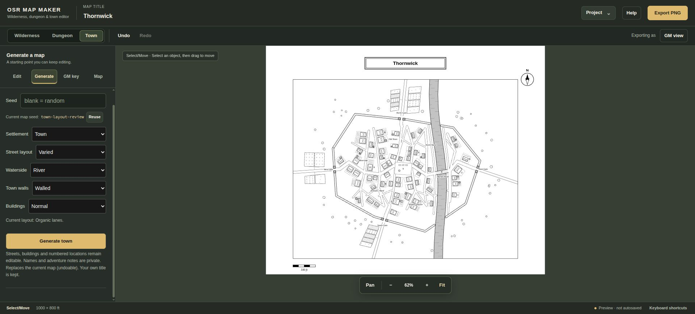

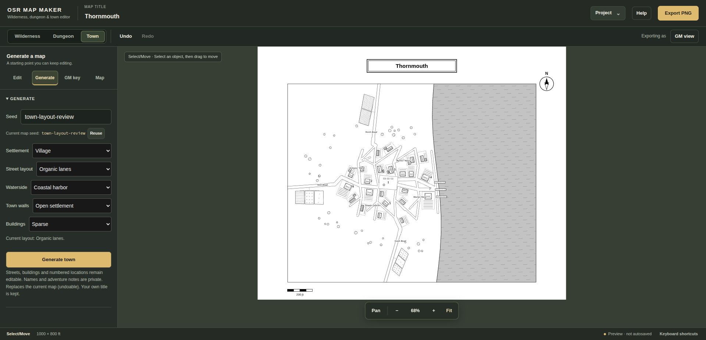

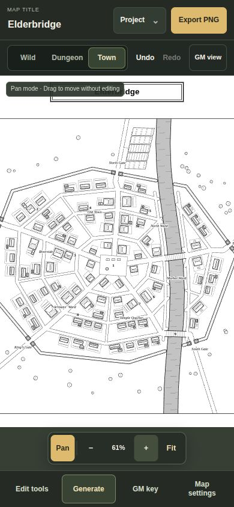

## Town road exits follow-up

Exterior approaches previously stopped 16 scaled units inside the drawing field
and used rounded caps. The paper margins made these routes look like dead ends.
New approaches now reach the actual field boundary, following the same full-width
dry-routing constraints. A visible map frame defines that boundary for both roads
and water; title, compass and scale remain outside it. Approach strokes use flat
caps and are clipped at the frame. Internal street junction styling is preserved.
Saved or manually shortened routes retain their endpoints until regeneration.

Verification: **239 Node tests pass** (52 town, 59 town variety, 45 wilderness,
67 dungeon, 16 storage). The new renderer regression checks both road passes,
exact clipping, the frame, export parity and preservation of edited endpoints.
Actual boundary assertions cover all five families, water modes and map shapes;
full road-width, tower, parcel, bridge and connectivity checks remain in place.
The village occupancy floor now allows 40 houses for smaller clustered villages
with multiple squares; town/city floors and density/size checks remain unchanged.
Native Chrome passes **2,429 desktop** and **2,431 phone-size** checks without
warnings or errors. Changes are local and unpublished.

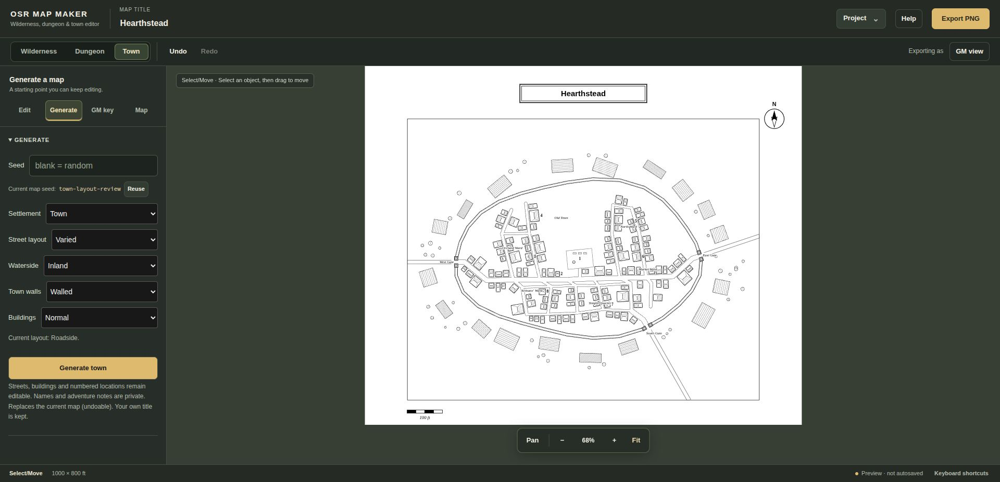

## Town layout variety follow-up

The repeated crossroads came from one radial street graph: every seed started
with the same market spokes and concentric connections. Fresh seeds changed
coordinates and buildings without changing that structure. The user's seed
field was already blank; seed reuse was not the cause.

- **Varied** now selects one of five seeded street plans: organic lanes,
  roadside high streets, clustered neighborhoods with local squares, market
  spokes, or planned blocks. Each family varies its junctions, connections and
  entrances. Gates connect to local streets instead of a mandatory central hub.
- The **Street layout** selector supports explicit choices on desktop and phone.
  **Current layout** describes the existing map. Changing the selector preserves
  the map until generation; legacy maps retain their saved geometry.
- Main street junctions stay on dry ground so river crossings run between dry
  banks. Existing tower, approach, road-width, frontage and bridge constraints
  remain checked across all five families.
- Review caught and fixed shared mutable street vertices that could move other
  roads while editing, and malformed imported neighborhood squares that could
  break rendering. Imported square lists are validated and bounded, with the
  original market as a fallback.

Verification:

- Shared validation passes **238 tests**: 51 town, 59 town variety, 45 wilderness,
  67 dungeon and 16 storage, plus syntax and shipped-asset checks.
- Native Chrome passes **2,429 desktop** and **2,431 phone-size** checks with no
  warnings or errors. The new layout selector and generation flow were also
  exercised at 390 × 844; the temporary viewport was reset afterward.
- Independent graph checks find **18 distinct junction/cycle signatures across
  24 seeds**, previously one. The user's sparse coastal village settings produce
  all five families and **15 signatures across 16 seeds**.
- Tests cover automatic/explicit replay, within-family variation, wide/tall maps,
  legacy rendering, spatial safety and independent road editing in every family
  and water mode. Read-only Codex review confirmed the two findings were fixed.
- Workflow lint and whitespace checks pass. Changes remain local and unpublished.

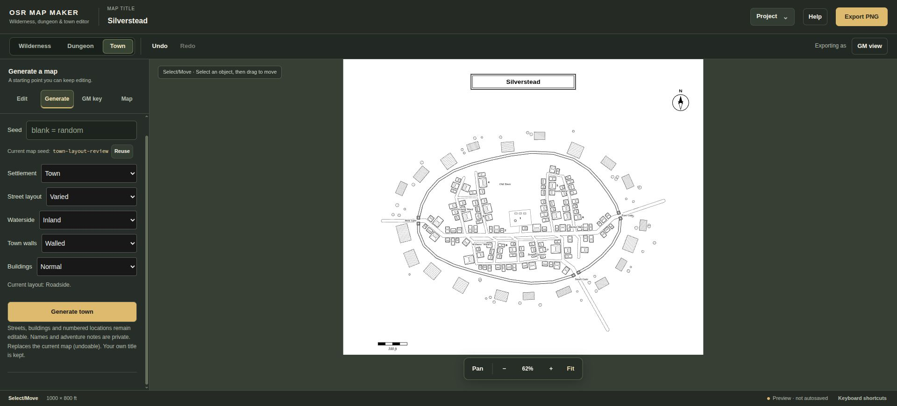

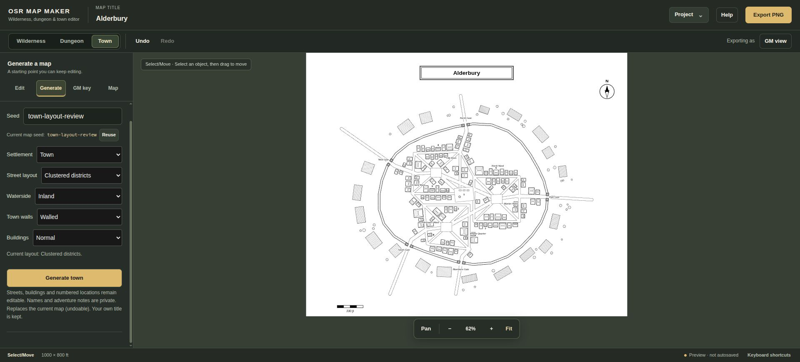

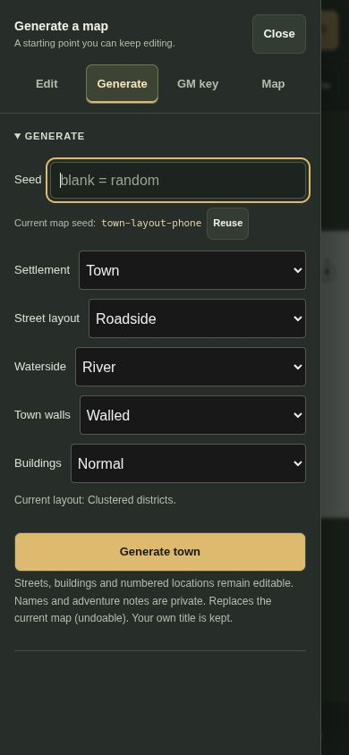

## Generator spatial-logic follow-up

The reported river/gate overlap reproduced with `release-town-2`, Village,
River, Walled, 1000 × 800. The earlier gate-center and connectivity checks did
not cover the complete gate towers, final street widths or approach after the
wall moved the gate. These are now explicit geometry constraints.

- **Town/city:** finalize the perimeter, dry gate towers and complete countryside
  routes before placing parcels. Street edges stay clear of riverbanks; bridge
  polylines span continuously between dry banks. Quays stay inside the perimeter,
  piers attach to their local shoreline, and buildings/fields/vegetation leave
  infrastructure clear. Open settlements use road labels without fortress towers.
- **Wilderness:** bridge locations use the same curved path the renderer draws.
  Road segments avoid following river channels; cached shared junction anchors
  move to a dry approach within their existing hex. Nearby distinct crossings
  retain their own bridges. Water labels remain on their actual water component;
  regional climate palettes stay consistent. Classic geography retains its
  documented legacy mixed terrain.
- **Dungeon:** normal layouts with Stairs No now have one real perimeter entry;
  Jaquays layouts keep multiple entries. Entry doors stay visible and unlocked,
  and area 1 matches the actual arrival chamber. Keyed notes place keys in an
  already reachable area before a locked route is opened, identify the door by
  wall/coordinate, supply retreat releases and put winches on both sides of a
  portcullis. Solid furnishings preserve routes to doors, keys and stairs.

Evidence from the same town seed:

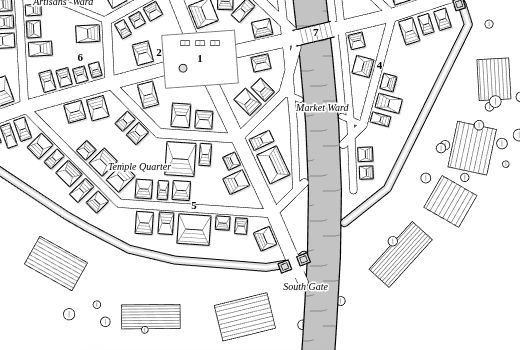

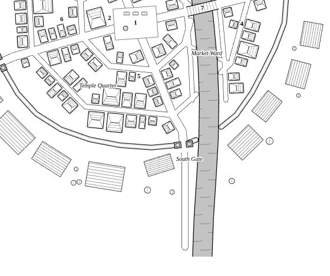

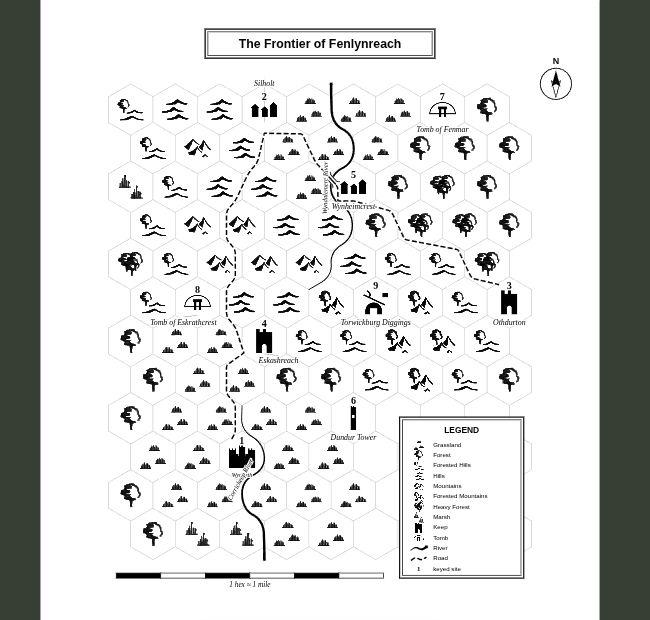

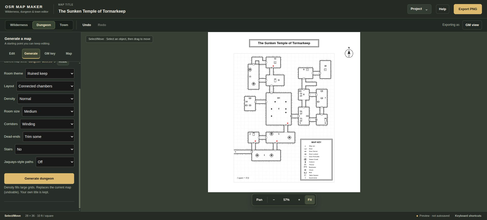

Verification for this follow-up:

- Shared validation passes **178 tests**: 50 town, 45 wilderness, 67 dungeon and
  16 storage. The new wilderness suite is included in the publishing gate.
- Native browser suite passes **2,420 desktop** and **2,422 phone-size** checks,
  without warnings or errors.
- Town sweeps include 72 entrance/connectivity cases, 48 physical footprint
  cases, an additional 200-town probe, and an independent 540-map dry-wall
  crossing sweep with no ungated crossings.
- Wilderness sweeps include 288 collision cases, 144 actual-crossing cases,
  90 river self/intersection cases and 27 independent narrow/minimum fixtures.
  No missing/floating bridges or sampled unsafe crossings remained in those runs.
- Dungeon probes cover 384 option/size combinations and both 120 × 120 layouts.
  Tests remove solid furnishing footprints, verify independent exterior entries,
  and collect keys before opening their locks. Intentional ordinary-layout
  secret rooms remain discovery-dependent; Jaquays ordinary routes remain usable
  without secret or one-way doors.
- Independent spatial review found no remaining concrete issue in these changes.
  Legacy two-point town bridges and current multi-point bridge edits/imports
  were also verified. Syntax, workflow lint and whitespace checks pass.

These are constraint-based, stylized maps rather than hydrology or settlement
history simulations. Improvements apply during generation. Existing edited
maps retain their geometry until the user chooses to regenerate.

## Release safety review

Verdict: no confirmed code blocker remains in the reviewed scope. This is a
release candidate; complete the manual browser/device gates below before a
public 1.0 tag. The review covered the full uncommitted app, all three
generators, storage, privacy, editing and both publication paths.

### Confirmed issues addressed

| Priority | Failure | Resolution |
| --- | --- | --- |
| P1 | A stale second tab could overwrite newer autosaved work, even by switching modes. | Compare storage with the exact loaded/last-written baseline; pause autosave, retain local edits and show backup/reload guidance on conflicts. |
| P2 | Pasting a private clipboard object into Player view exposed its text in Selection. | Reject hidden/private clipboard objects before mutation, selection or history changes. |
| P2 | Hiding a layer left its selection editable and deletable. | Clear only selections that become invisible, across all map types. |
| P2 | Hidden dungeon exits still revealed openings in the page perimeter. | Exit frame openings follow symbol visibility and GM-layer filtering. |
| P2 | Deleting early locations renumbered survivors and silently retargeted route notes. | Stable v4 key numbers and monotonic allocation counters keep references consistent; new locations never inherit deleted numbers. |
| P2 | Town approaches resumed across rivers as disconnected road fragments. | Plan dry gates and complete countryside approaches before parcels; remove disconnected fragments. Full-width bank and bridge checks now guard final infrastructure. |
| P1 edge case | Extreme malformed key numbers could hang repair or cause an unsuccessful startup migration to be mistaken for a clean load. | Bounded, atomic numbering repair plus post-migration validation, quarantine and backup-recovery regressions. |
| Release guardrail | Pages and GHCR could publish despite failing tests; parallel GHCR runs could roll back `latest`. | Shared syntax/asset/Node validation gates both publishers; Docker publications are serialized. |

Stable key migration keeps legacy positions and plain GM notes unchanged. Use
v4 for v4 projects. Deleting a referenced destination intentionally leaves a
note requiring manual editing; it no longer points silently to a different
surviving location. Close older app tabs and save JSON before upgrading.

### Final verification

- Native Chrome browser suite: **2,420 desktop checks** and **2,422 checks at
  390 × 844**, with no browser warnings or errors.
- Shared `node scripts/validate.cjs` gate: **178 passing tests** — 50 town,
  45 wilderness, 67 dungeon and 16 storage — plus inline/external JavaScript syntax and
  required runtime-asset checks.
- `actionlint` passed for validation, Pages and GHCR workflows; diff whitespace
  checks passed. Disposable negative fixtures verified that invalid inline
  JavaScript and a failing test both stop the validation command.
- The final storage cases exercise production migration, sanitization, loading
  and saving, including the exact malformed legacy exhaustion fixture. The raw
  save is quarantined; a valid backup restores, and the no-backup path retains
  the damaged original for recovery.
- All review work used Codex. Changes are local, uncommitted and unpublished;
  the new runtime, workflow, script and test files must be included when committed.

### Flow evidence from this review

1. **Wilderness generation — pass.** Map controls, interior numbers and fitted
   map were inspected in desktop Chrome.
   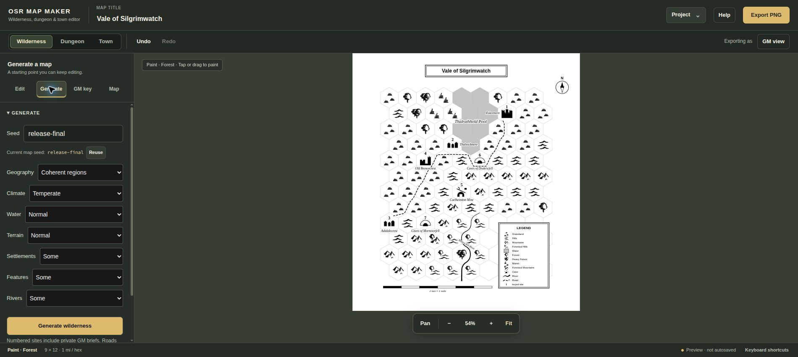
2. **Private note editing — pass.** A generated site's private name and notes
   were edited and saved through the modal.
   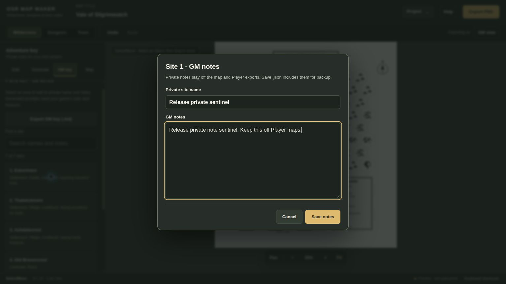
3. **Player view and undo/redo — pass.** The private sentinel text and GM export
   controls stayed absent after switching views and undoing/redoing.
   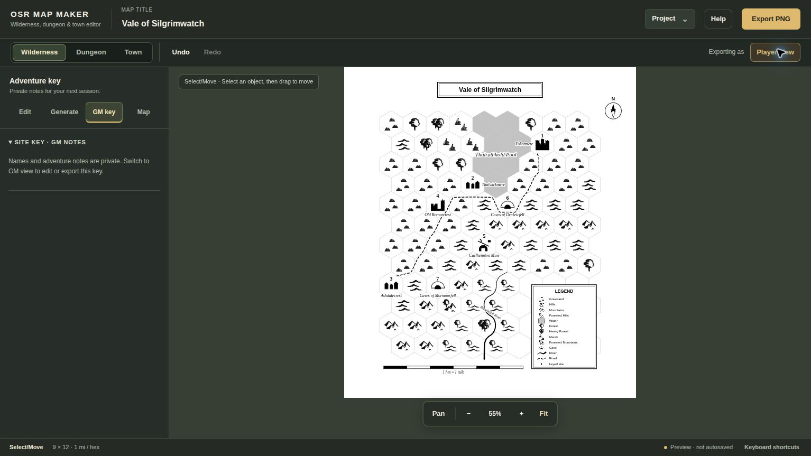
4. **Phone tools — pass in Chrome emulation.** At 390 × 844 the generator drawer
   fits, controls remain accessible, and Close returns focus to navigation.
   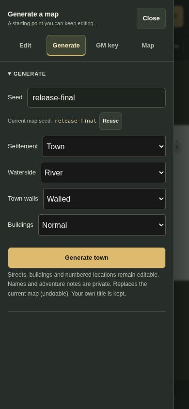
5. **Two-tab saving — pass.** An isolated local origin was used so user maps
   were untouched. Tab B retained its unsaved title with a persistent warning;
   reloading Tab A retained A's saved work.
   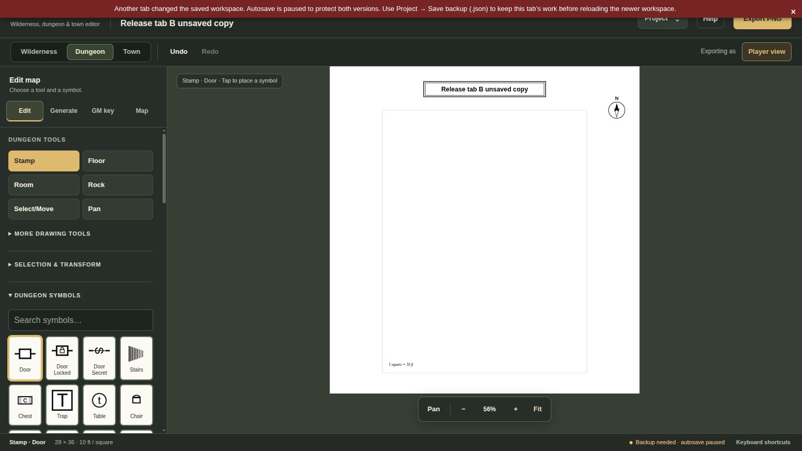
6. **Town generation — pass.** The riverside village regression seed was
   generated through the on-screen controls and inspected after the road fix.
   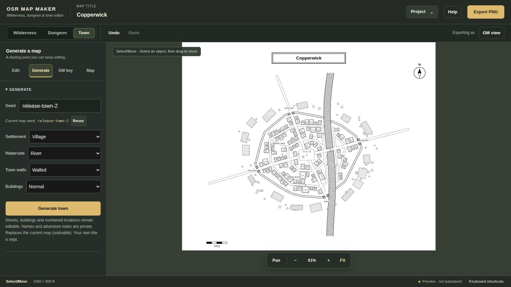
7. **Actual file open/save — partial coverage.** Native raster/encoding and
   migration/storage checks pass. Clicking PNG export produced no app error,
   but the browser tool did not report download completion. Automated file
   import was blocked by Chrome extension file-URL permissions; permissions
   were left unchanged. Reopening actual JSON/PNG/Markdown files remains manual.

### Gates before a public 1.0 tag

- Run the browser `?test` suite and a generate/edit/save/reopen/export smoke test
  in Firefox and Safari, plus a real phone with touch and its virtual keyboard.
  Open downloaded PNG, JSON and GM Markdown files outside the app.
- Confirm the new GitHub validation workflow and the selected publishing path
  succeed on this exact revision. No push, deployment or release tag was made.
- If accessibility support is a release promise, test an actual screen reader.
  Canvas editing remains pointer-oriented; Chrome emulation is not physical
  touch or assistive-technology certification.

A short table session with the generated keys remains useful playtesting.
Organic caves, VTT wall/door export and linked multi-floor projects are feature
follow-ups, not demonstrated failures of the current generation options.

Docker packaging was reviewed statically. A local container build was not run
because access to the Docker daemon was denied. The app has no runtime CDN,
font or API dependency, and all script assets are included by both publishers.

## Earlier implementation reviews

The sections below retain historical evidence and earlier check counts. The
final audit above supersedes their resolved checklist items.

The editor, private browser storage, seed reuse and GM/player exports are a useful
foundation. The principal playability gap was that generation produced geography
and numbered floors without the information needed to run those locations.
The earlier passes fixed concrete generation/privacy bugs and added editable
adventure keys and responsive controls. The latest pass adds original town
generation and changes dungeon and wilderness structure. It has browser regression coverage; the remaining cross-browser, accessibility
and actual-play checks remain open.

## Findings fixed

| Severity | Reproduction / problem | Result |
| --- | --- | --- |
| P1 | Load a public map, then undo to a map whose symbols were hidden by a GM-only layer. Old objects returned under the new public layers. | Undo/redo restores complete map settings and layers. It preserves the active GM/player display, so undoing a GM edit on a Player screen cannot reveal secrets. |
| P1 | Generated secret/concealed doors and room traps appeared in Player maps and their legends. Hiding the glyph alone left an obvious opening. | Generated, stamped and imported secrets default to GM-only. Hidden snapped secret doors draw as continuous walls in Player view. Explicitly revealed `gm:false` objects remain revealed. |
| P2 | Dungeon 18×24, Packed, seed `audit-1`: a corridor ran along a room wall and left a wide opening without a door. | Routing enters room walls perpendicularly and protects existing door flanks. Connectivity retries follow the same rules. Redundant corridor corners are removed only when floor connectivity is preserved. |
| P2 | Jaquay on, Stairs no, seed `dq-a`: ladders, trapdoors and stairs still appeared. | Vertical links respect Stairs no; loops and an edge exit remain. |
| P2 | Wilderness 20×20, Wet, Many settlements, No rivers, seed `water-road-0`: ordinary roads crossed water to an island. | Roads form a forest of land-only networks. Island settlements remain. Rendering retains land-safe curve vertices instead of taking shoreline shortcuts. |
| P2 | Imported theme `toString` or `__proto__` could resolve an inherited object property and crash generation. | Themes use a canonical, own-property allowlist and safe fallback. Invalid room/site note fields are discarded. |
| P2 | `?test` without an existing autosave left generated fixtures in the workspace. | Tests suppress autosaving and restore the in-memory project and history afterward. |

## Flow evidence

All screenshots were captured and inspected during this review. Steps 1–2 show
the live site before changes; steps 3–6 show the local implementation.

1. **Generate a dungeon — readable, playability gap fixed.** Symbols, numbered
   rooms and clear doors worked, but there was no adventure key. Full-field
   hatching dominated the floor plan. Connectivity and doorway bugs required
   seeded logic checks, beyond this screenshot.

   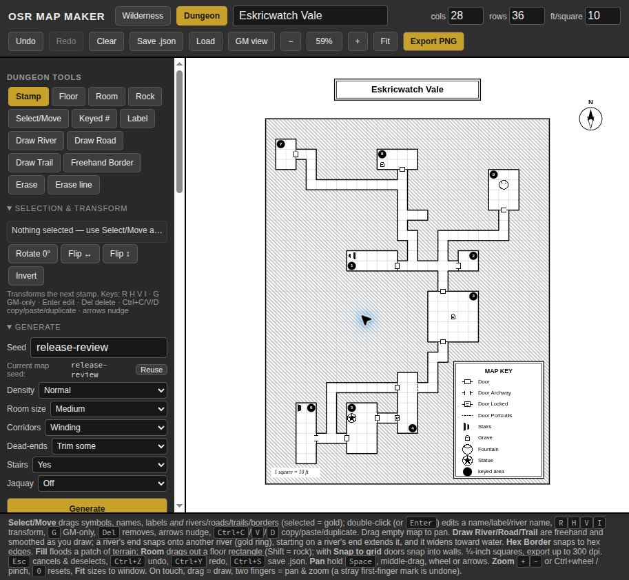

2. **Generate wilderness — readable, sandbox gap fixed.** Named landmarks were
   useful map decoration but lacked keyed residents, services and hooks. The
   water-road bug came from a separate reproducible seed, not this screenshot.

   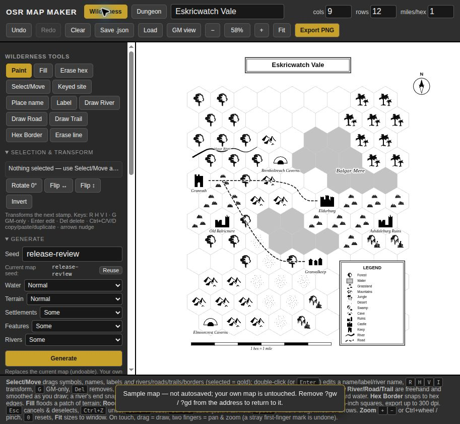

3. **Edit a private room key — passing in Chrome.** A modal gives the room a
   private name and notes. Themes provide a faction, objective, quiet rooms,
   discoveries, interactive tricks, negotiable encounters, treasure and hazards
   with visible tells and bypasses. Save, cancel, undo and redo were checked.
   The real GM Markdown download was inspected on disk.

   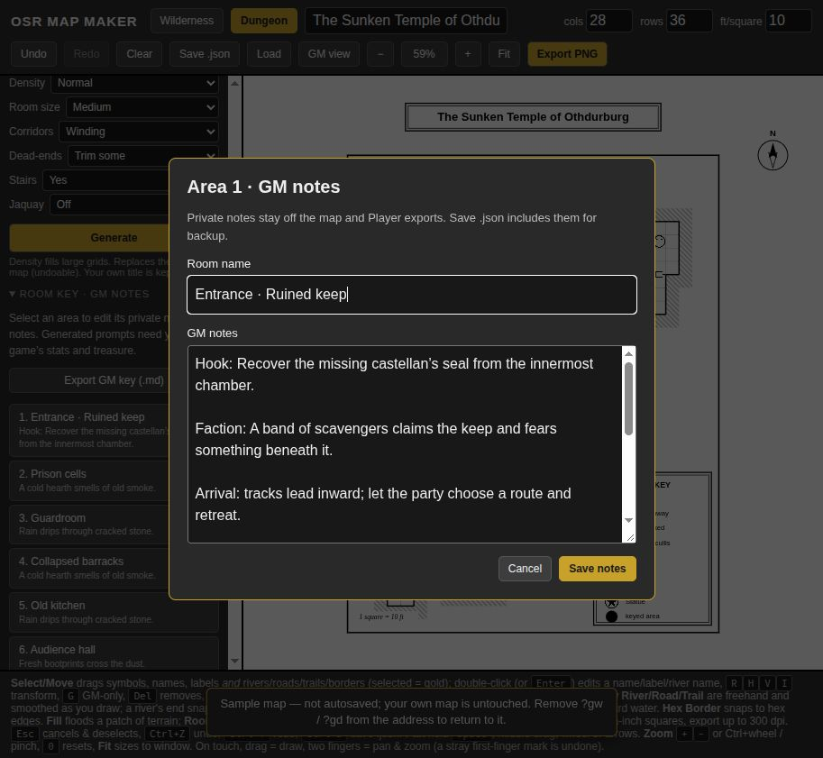

4. **Switch to Player view and export — passing in Chrome.** Private names,
   note text and GM-key export controls disappear. A real Player PNG was
   downloaded. Pixel tests separately check hidden secret-door walls, including
   both orientations, ordinary doors and deliberately revealed secrets.
   JSON remains a full project backup containing secrets, as its tooltip and
   editor copy explain.

   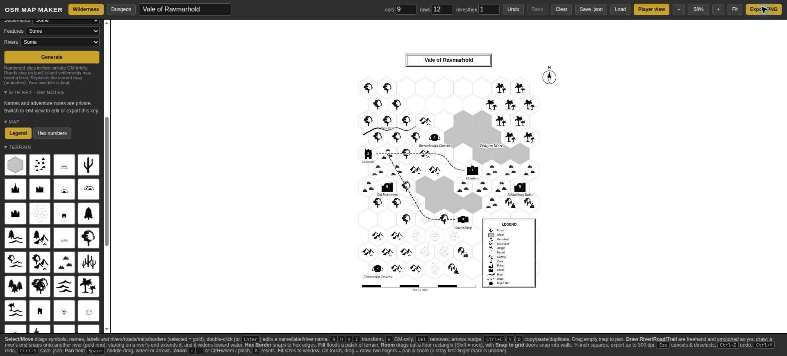

5. **Read the dungeon silhouette — improved.** Walls-only hatching and floor-only
   grid are the new-project defaults. All-rock and unshaded alternatives remain
   selectable. The floor topology is unchanged by presentation options.

   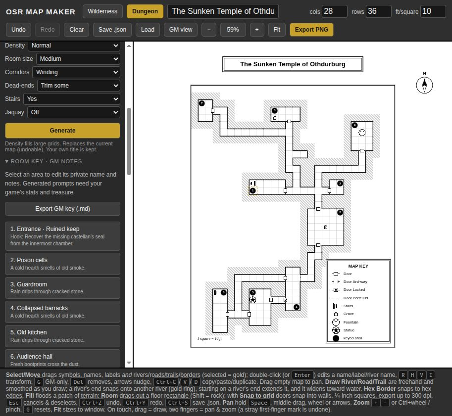

6. **Prepare a sandbox location — passing in Chrome.** Generated land sites now
   have numbers and private briefs. Settlement notes include livelihood,
   current trouble, a useful service, a resident motive and a choice with
   consequences. Every multi-site brief points to a real numbered destination
   and hex coordinate. Water names remain plain labels. The same editor and
   Markdown export work for dungeon rooms and wilderness sites.

   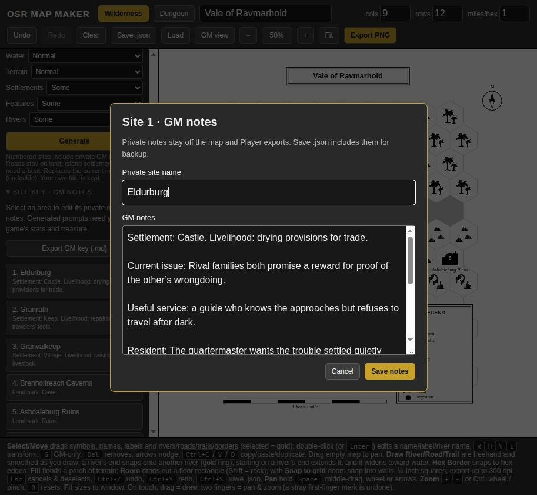

## Verification and limits

- Chrome's actual in-page `?test` suite passed **1,971 checks**, including canvas
  pixel tests. A separate Node VM run passed the logic checks; its stub canvas
  is not rendering evidence.
- Dungeon sweeps covered 400 baseline maps, 320 varied-option maps and 400
  additional cramped/asymmetric maps. Every tested floor set was connected and
  every tested room opening properly doored. Two additional 120×120 fixtures
  also passed. A few asymmetric cases retain small wider corridor junctions;
  there is no universal claim of exclusively one-cell-wide passages.
- Wilderness validation covered 200 wet-map seeds, 1,925 roads and 333,909
  samples of the actual rendered quadratic curves, with no water/reserve
  crossings. Settlements remained connected within their landmasses.
- Room/site content has an independent seeded RNG. Regeneration, malformed
  imports, note persistence, note editing undo/redo, and Player export guards
  have regression checks.
- JavaScript syntax and diff whitespace checks passed. Review used Codex only.
- The initial phone screenshot was rejected because its viewport was wrong.
  The UI follow-up below subsequently verified phone/tablet layouts in Chrome
  emulation. Safari, Firefox, real touch input/virtual keyboards, screen-reader
  navigation, printing and actual-session encounter balance remain outside
  the completed verification.

## Remaining 1.0 checks and next improvements

Before tagging 1.0:

- Run the invariant suite and a save/load/export smoke test in Firefox, Safari
  and a real phone browser, including large PNGs and the native notes dialog.
- The shared Node/syntax/asset gate now runs before both publishers. Native
  browser `?test` checks remain a manual release step.
- Test screen-reader use of the mobile tools drawer on a real device. Keyboard
  containment, dismissal and focus return have now been checked in Chrome;
  actual assistive-technology behavior still needs coverage. Canvas editing
  remains pointer-oriented.
- Stale-tab overwrite protection is now implemented and verified. True
  simultaneous editing and merging are not supported.
- Run a short dungeon and wilderness session from generated keys. The prompts
  intentionally require the GM to choose rules, statistics and treasure values.

Highest-value next product work:

1. Organic caves, round/irregular chambers and deeper theme-specific dungeon
   zones. Compact branching layouts and larger halls now exist, but rooms
   still use rectangular floor geometry.
2. VTT export with selectable pixel-per-square scale, tight bounds, optional
   grid/legend/frame, and separate wall/door data.
3. Linked wilderness-to-dungeon projects and multiple levels, preserving named
   entrances and exits between maps.
4. Connected factions, clocks and regional encounter lists. The new town
   generator supplies keyed services and contacts; deeper urban encounter
   tools can build on those locations.

## Reference grounding

[Watabou's One Page Dungeon Generator](https://watabou.github.io/one-page-dungeon/)
was inspected in the browser: varied room shapes, compact composition and
wall-adjacent hatching are useful targets. The initial pass added cleaner
shading and keyed content. The generation follow-up below improves compact
composition and wall detail; it does not claim comparable organic geometry.

[Courtney Campbell's author overview](https://hackslashmaster.blogspot.com/2011/02/on-tricks-empty-rooms-and-basic-trap.html)
informed interesting quiet rooms and interactive hazards.
[Robert Conley's sandbox article](https://batintheattic.blogspot.com/2009/08/how-to-make-fantasy-sandbox.html)
informed keyed settlements, residents and linked rumors.
[d30's publisher overview](https://www.newbigdragon.com/accessories.html) and
[Tome of Adventure Design's publisher description](https://www.mythmeregames.com/products/tome-of-adventure-design-hardcover-book)
helped scope system-neutral settlement and adventure prompts.

The supplied shortlinks were inaccessible; full chapters and proprietary tables
were not reviewed or reproduced. The new prompt text is original.

## Desktop and mobile UI follow-up

The workspace now separates **Edit**, **Generate**, **GM key**, and **Map**.
Project actions live in a compact menu; Export and GM/Player view stay visible.
The long help footer is replaced by an accessible field-guide dialog. Pan and
zoom have persistent controls, with space reserved around the fitted map.

1. **Desktop editing — passing.** Six primary tools, collapsed advanced tools,
   searchable palettes, common symbols first, visible icon names, and a current
   tool/brush status replace the mixed sidebar. Map options and saved snapshots
   are under Map.

   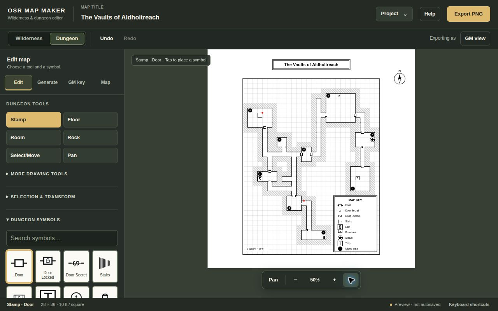

2. **Phone navigation — passing in emulation.** The previous offscreen toolbar
   and cropped map are replaced by a compact header, fitted map, and bottom
   panel navigation. Pan allows one-finger movement without painting.

   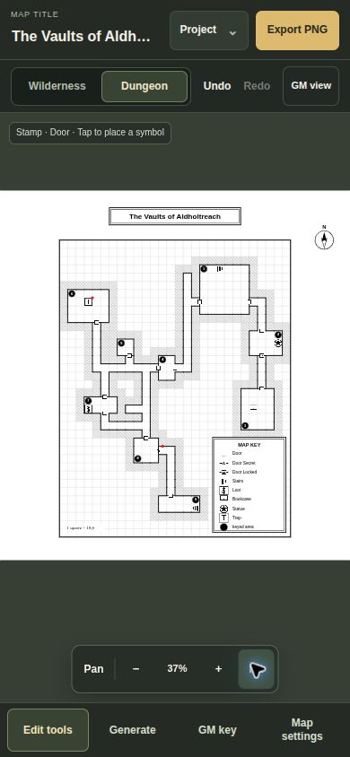

3. **Generation drawer — passing.** Options and the generation action are easy
   to reach. Background controls become inert; the drawer traps keyboard focus,
   closes with Escape/backdrop/Close, and returns focus to its trigger.

   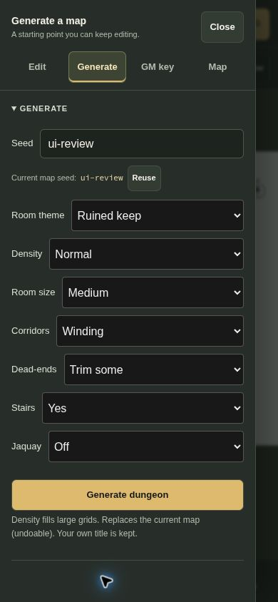

4. **Map settings and undo — passing.** Original dimension/scale controls retain
   their event listeners when panels rebuild. Native number-field editing
   resizes the map, and Undo reverses only that resize, keeping rooms and seed.
   New DOM-event regression checks cover this path.

   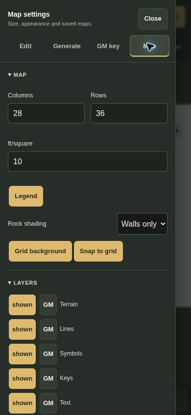

5. **Private notes — passing.** Search matches names and notes, including an
   explicit empty state. Native dialogs have clear labels, persistent save
   actions, keyboard save/cancel, and viewport-aware placement. Focus returns
   to the rebuilt key button, or the drawer close button if a rename no longer
   matches the search. Inline inputs stay within the visible viewport.

   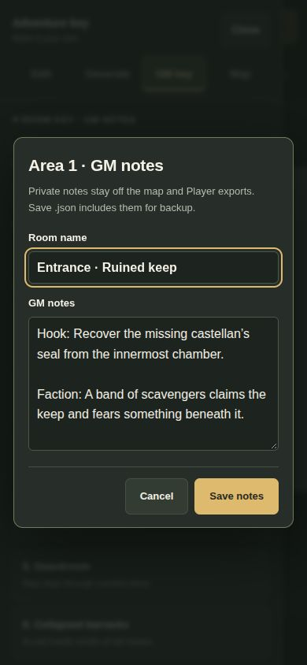

6. **Landscape and resizing — passing in emulation.** Short landscape screens
   use the same drawer layout. Fitted cameras adapt to container changes;
   manual zoom is preserved. Map navigation stays clear of the fitted page.

   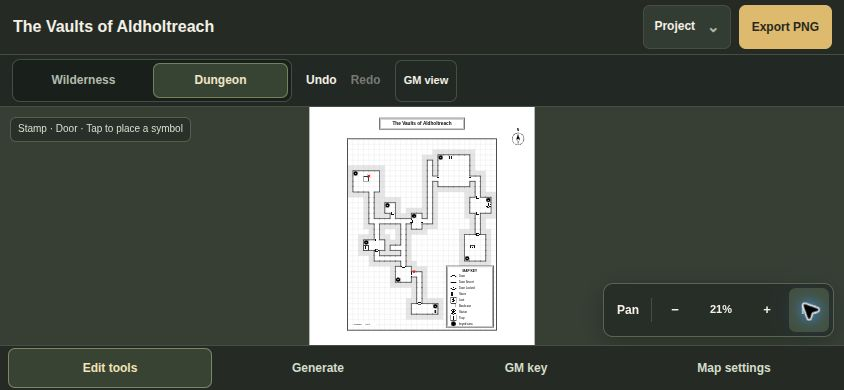

The browser suite passed **1,984 checks at desktop size** and **1,986 at phone
size**, with no console warnings/errors. Responsive checks covered 320×740,
390×844, 768×1024, 844×390 and 1280×800, with no horizontal page overflow.
Native resizing/undo, key search, note saving, focus recovery and mobile Help
access were exercised. JavaScript syntax and whitespace checks passed. The
remaining real-device, Safari/Firefox and assistive-technology checks above
still apply.

## Generation follow-up · town, dungeon and wilderness

The supplied One Page Dungeon example exposed a structural gap: attractive wall
shading alone could not make widely scattered rectangular rooms read as a
coherent building. This pass changes placement and terrain structure and adds a
third independently saved map mode. All new generator code and adventure text
are original.

### Town

`town.js` is a dependency-free settlement engine. A seed and settlement options
produce a village, town or city with a reserved market, connected streets,
road-facing building footprints, districts, countryside approaches, farms and
trees. River towns have bridges; coastal towns have quays and timber piers.
Walls are optional, and gates sit on the finished perimeter with roads leading
to the market.

Town is integrated with the editor, autosave, named snapshots, JSON save/load,
undo/redo, scale, layers, GM/Player views and PNG export. Buildings, location
numbers and streets can be moved or removed; bridges linked to a street move
with it. Labels, buildings, keyed places and additional streets can be added.
**Select building** reaches a building beneath a numbered location. Streets and
buildings remain ordinary stored geometry rather than an embedded generator
image. Editing does not regenerate neighboring parcels or enforce new building
clearance automatically.

Numbered services include private names, contacts and adventure leads. Canvas
maps show numbers, public district names and gate names; private location names
and notes remain in the GM key. GM-only objects and layers are omitted from
Player view and PNGs. JSON is a complete project backup and contains secrets.
Each mode retains its own map, seed and generation options. `?gt&seed=abc` opens
a town preview without autosaving. Pages and Docker packaging now include
`town.js`.

### Dungeon and wilderness

- **Connected chambers** is the dungeon default. Original room-frontier growth
  creates compact clusters, a larger hall, short connections and galleries.
  Columns and furnishings give rooms a purpose. **Scattered rooms** preserves
  the previous placement option. Rooms are still rectangular, including the
  excavated cavern theme; this does not implement round rooms or organic caves.
- Walls receive short, deterministic outward hatches clipped to rock, and floor
  grids use light dots. Columns are small editable discs with a **Column**
  legend entry. Full-rock and unshaded presentation options remain available.
- **Coherent regions** is the wilderness default. Elevation and moisture fields
  create continuous mountain ranges, foothills and lowlands. Temperate, arid and
  cold climates choose suitable terrain families. Settlement placement favors
  usable ground and shores; river routing penalizes uphill movement. **Classic
  patches** retains the older approach. Land-only road routing remains in use.

### Repository research and originality

The review covered the eight public repositories visible under
[watabou](https://github.com/watabou/): **TownGeneratorOS**, **pixel-dungeon**,
**switch-hook**, **PD-classes**, **RuneGeneratorOS**, **CompassOS**,
**pixel-dungeon-gdx** and the **openfl.org** website fork. Metadata and READMEs
were reviewed for scope; relevant TownGeneratorOS, pixel-dungeon and switch-hook
source was examined for design principles. The current public repository list
did not contain One Page Dungeon's source. TownGeneratorOS's README also notes
that its public source omits some features of newer online versions.

| Reference | Lesson used in the independent implementation |
| --- | --- |
| [TownGeneratorOS Model](https://github.com/watabou/TownGeneratorOS/blob/master/Source/com/watabou/towngenerator/building/Model.hx), [Topology](https://github.com/watabou/TownGeneratorOS/blob/master/Source/com/watabou/towngenerator/building/Topology.hx) and [Ward](https://github.com/watabou/TownGeneratorOS/blob/master/Source/com/watabou/towngenerator/wards/Ward.hx) | Reserve circulation first; connect a market and gates; let districts influence the sense of place. The new town engine uses its own street-first frontage placement rather than copying the Voronoi implementation. |
| [pixel-dungeon RegularLevel](https://github.com/watabou/pixel-dungeon/blob/master/src/com/watabou/pixeldungeon/levels/RegularLevel.java), [Room](https://github.com/watabou/pixel-dungeon/blob/master/src/com/watabou/pixeldungeon/levels/Room.java) and [StandardPainter](https://github.com/watabou/pixel-dungeon/blob/master/src/com/watabou/pixeldungeon/levels/painters/StandardPainter.java) | Treat rooms as a connected plan, deliberately place loops and branches, and furnish rooms consistently with their role. The new compact placement grows rooms from a frontier. |
| [switch-hook HexMap](https://github.com/watabou/switch-hook/blob/master/Source/com/watabou/switchhook/geography/HexMap.hx) and [Level](https://github.com/watabou/switch-hook/blob/master/Source/com/watabou/switchhook/geography/Level.hx) | Prefer contiguous regions and use connectivity when placing objectives. The wilderness implementation uses its own seeded elevation and moisture fields. |

No reference code, art, generated maps or generated text was copied. Existing
third-party icon credits remain in [CREDITS.md](CREDITS.md).

### Current validation status

The standalone town engine suite passes **36 tests**, covering deterministic
JSON, 27 seed/size/water combinations, independent polygon/road/water clearance,
gate placement, line/building/key selection, layer visibility, linked-bridge
privacy and the rendering contract. An additional 78 coastal generation/render
cases completed within bounded operation budgets.

Native Chrome checks cover Town generation, editing, linked building and bridge
movement, deletion/undo, cross-mode restoration, malformed imports and duplicate
IDs, private note editing, Player canvas output and populated PNG encoding.
The final native Chrome suite passes **2,296 checks at desktop size** and
**2,298 at phone size**. The passing desktop run produced no console warnings
or errors. The three-mode toolbar fits a 320-pixel viewport. Mobile cancellation,
coastal regeneration and Undo restoring the river town were also exercised
through the UI. The screenshots below show the finished generation pass.

Review also fixed imported duplicate/missing IDs selecting the wrong object,
unsafe hatch scales, degenerate bridges, labels losing selection to roofs, and
key markers blocking access to their underlying buildings. Dungeon furnishing
placement now finds legal cells instead of rejecting most small-room furniture;
210 furnishing cases had no empty rooms, blocked approaches or disconnected
walking routes. A separate 254-case geometry stress run passed, including
120×120 grids. A consistent in-app
confirmation now precedes replacing generated maps; cancel keeps the old map.

The export button was exercised, but the browser connector did not report a
completed download. File download completion is therefore not claimed; native
canvas rendering and PNG encoding are covered. Real-device and cross-browser
checks, automated browser gating before deployment, VTT exports, organic/round
rooms and linked multi-level maps remain open. This pass does not by itself
establish readiness for a 1.0 tag.

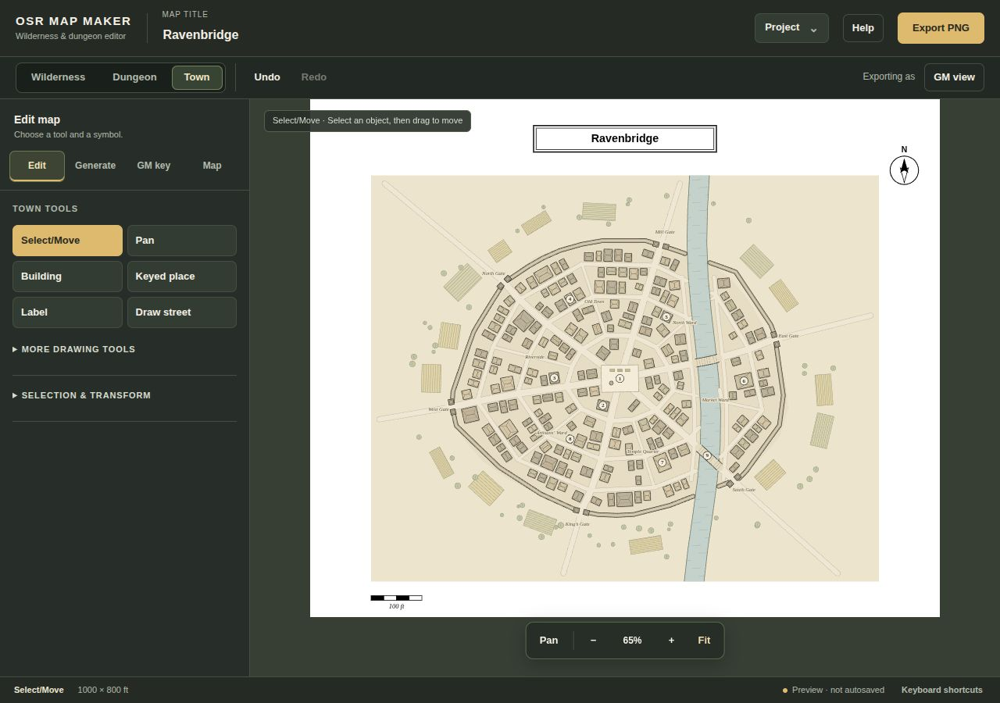
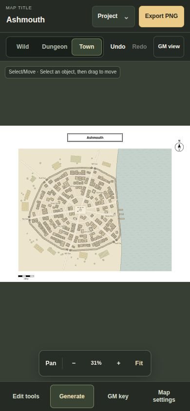
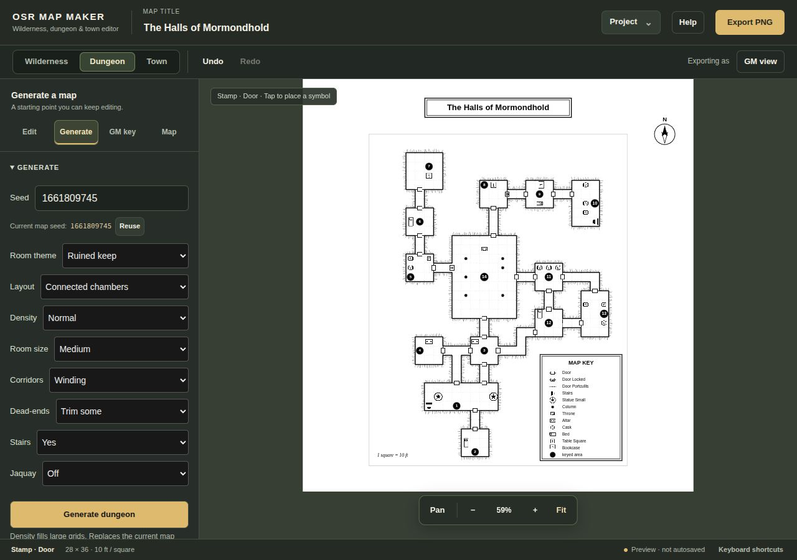
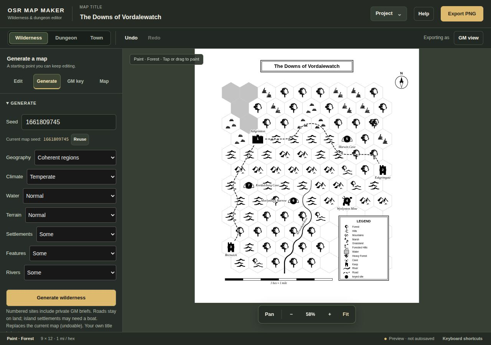

## Map readability follow-up

Key markers now use plain numerals. Wilderness numbers sit above the artwork;
town numbers avoid building roofs and other numbers. The number, site and name
remain selectable. Grabbing an offset wilderness number preserves the pointer
offset, preventing a small drag from jumping into the neighboring hex. Dungeon
room keys and legend samples use the same plain-number style.

Generated wilderness roads now follow shared peripheral lanes instead of hex
centers. Bounded corner rounding preserves clearance for both the ink and the
paper casing. Existing/manual path data is preserved; regenerate to adopt the
new routing. The screenshot seed `3ra257g7` retains its terrain, sites and title.

Validation: **2,306 desktop checks**, **2,308 phone checks**, and **38 town tests**
pass. A road sweep covered 216 maps, 1,246 roads and 620,658 samples of actual
rendered curves with no icon, water or reserve crossings. Small/asymmetric grids
and 120×120 also passed. Plain-number rendering, building-art preservation,
number picking/dragging, hex-coordinate spacing, name placement, privacy and
export behavior have regression coverage.

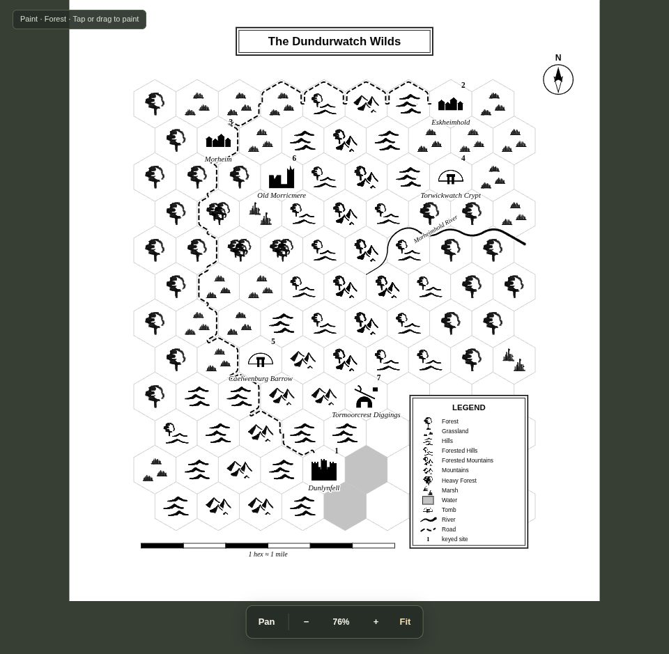

## Hex-boundary road joins

Paired inset portals made roads turn inward briefly at each shared hex edge.
Generated road geometry now removes those short steps and deep detours while
preserving chain endpoints and junctions. A shallow corner clearance keeps the
full paper casing away from neighboring water and reserved hexes. Saved
hex-edge roads are normalized during loading, so painting, picking, bridges and
exports use the same corrected geometry; manual paths remain unchanged.

Validation: **2,310 desktop checks** and **2,312 phone checks** pass. The road
sweep covered 216 maps, 1,246 roads and 492,870 rendered-path samples, with no
icon, water or reserve crossings. The screenshot seed, 24 small/asymmetric maps
and 120×120 passed. New checks cover every crossing orientation, full-casing
clearance beside water, fixed endpoints, idempotency and saved-road migration.

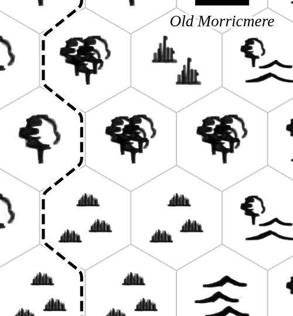

## Roads through open hex ground

Roads now take direct paths through free space inside hexes and detour around
icon footprints. A local visibility graph searches the existing road corridor
and adjacent dry hexes. Settlement approaches and shared junction endpoints
remain connected; per-corner rounding is checked against the full road casing.
Stored points and corner profiles keep rendering, picking, bridges and saves
in agreement. Existing manual paths retain their geometry; regenerate older
maps to adopt the interior routes.

For `3ra257g7`, the route is **16.9% shorter** (1,085.4 versus 1,305.8 logical
pixels), with 23 points instead of 71. Terrain, sites, notes, title and chain
endpoints match the previous seed. Independent sampling finds substantial travel
inside hex interiors, rather than only along their edges.

Validation: **2,316 desktop checks**, **2,318 phone checks**. The 216-map sweep
covers 1,246 roads and 389,115 rendered samples without icon/water/reserve
crossings. A separate full-casing audit covers 72 maps and 255,041 rendered
samples against water, reserve and outside polygons. Small/asymmetric and
120×120 maps also pass. Shared point arrays were corrected so resizing moves
each road once and moving one road cannot move another's endpoint; native
regressions cover that behavior plus saved geometry and corner profiles.

## Unified monochrome cartography

All three map types now share white paper, black ink, neutral gray shading,
serif location labels and plain numbered keys. Town roofs, crops, water, walls,
market objects, trees and shadows were converted together. Fine hatch and line
patterns preserve the town's detail. The shared palette is supplied by the
editor to the town renderer, with matching standalone defaults.

The audit also found a warm dungeon-frame color and tinted pixels in all 86
dungeon PNG assets. The frame is neutral gray, and a cached grayscale raster
preserves icon dimensions and transparency across maps, legends and previews.
The original bundled assets remain intact. Editor controls, selection accents
and GM indicators retain their UI colors; exports suppress those overlays.
Existing saved maps adopt the presentation without regenerating their data.

Validation: **2,328 desktop checks**, **2,330 phone checks**, and **43 town
tests** pass. Browser checks now wait for artwork loading before testing all
136 actual assets. Strict native-canvas pixel audits require equal RGB channels
for GM and Player exports of wilderness, dungeon, inland town, river town and
coastal town fixtures, including active selections. Alpha preservation and
standalone renderer colors/patterns also have regression coverage. Syntax and
whitespace checks pass; the scoped source review found no remaining color leaks.

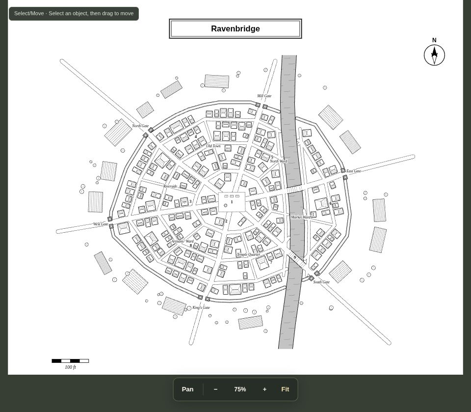
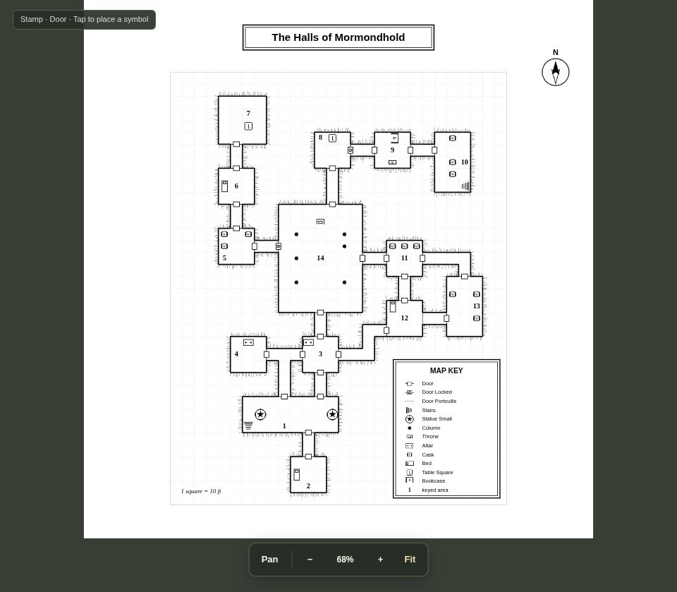
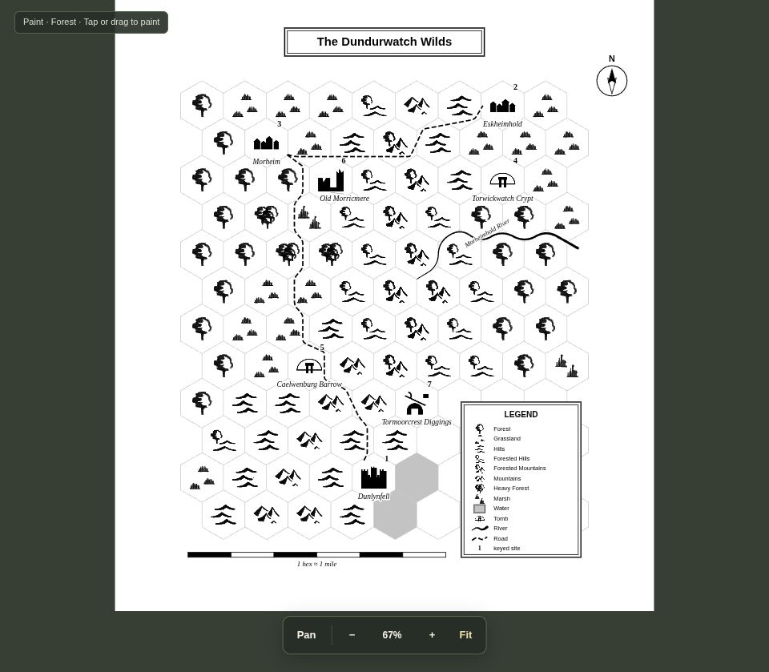
### Interior wilderness site numbers

Keyed site numbers now fit entirely inside their own hexes, above the icon or
below it when hex coordinates are enabled. Native text measurements include
the white glyph outline; numbers start at 18px and adapt to the available cap
space without covering artwork, including rotated symbols and multi-digit keys.
Crowded name placement reserves the number and coordinate bands, and keys draw
above roads, label leaders and free text. Clicking and dragging still select
and move the original site without a jump. Hidden, unnamed keys no longer leave
invisible selection targets.

Validation: 2,331 desktop and 2,333 phone-size native browser checks passed,
including every bundled hex icon with one through five-digit numbers, rotated
icons, coordinate mode, crowded labels, click/drag, and grayscale exports.
Codex source review found no remaining issue in this change.
Preview: `review/keyed-site-numbers.png`.

## Jaquays-style paths

The earlier option counted planned links and extra glyphs without proving that
those routes existed. Failed corridor attempts could silently disappear; a
straight-only exit search could produce no exit on cramped scattered maps.

The generator now accepts loop additions only when the actual room-contracted
floor graph gains a circuit. It keeps a public alternate route usable without
secret or one-way doors, supports parallel paths between two rooms, retries
failed routes, and checks narrow passage geometry. Two independent rock-routed
entrances can bend around obstacles and reach distinct keyed areas. Random
blind stubs are omitted in Jaquays mode.

GM-only endpoint letters pair a lower service passage (A), a narrow maintenance
crawl (B), and a concealed one-way chute (C). Both endpoints have real area
references, discovery cues, clearance/travel details and return rules in private
GM notes. Vertical detours run through a described off-map undercroft or conduit
and rejoin the current map; this does not add a multi-floor editor. Stairs No
suppresses all vertical symbols and prose while retaining horizontal routes.
The ordinary sequential clue chain is omitted in Jaquays mode. Existing saved
maps are preserved; regeneration applies the improved layout.

Validation: 2,356 native desktop checks and 2,358 checks at 390 × 844 passed with
no browser warnings or errors. The new standalone dungeon suite passes 44 tests
using the production generator and stocking functions, covering public topology,
per-map entrances, known small-map regressions, doorway geometry, endpoint
notes, Stairs No, option Off, deterministic seeds, JSON and GM-key privacy.
An independent 240-map probe also passed; a 120 × 120 geometry probe generated
140 rooms, 56 mapped cycles and two entrances in 4.29 seconds (rendering and
room stocking were stubbed in that performance probe). Codex source review
found no remaining actionable issue in this change.

Browser verification also exercised the On selector, regeneration dialog and
paired route notes through the normal UI. Preview: `review/jaquays-dungeon.png`.
